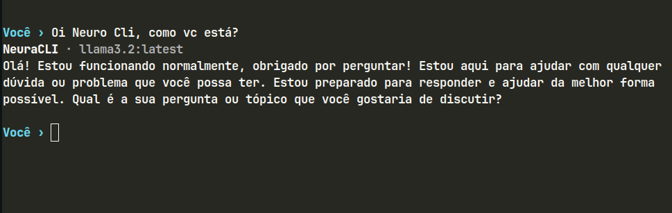
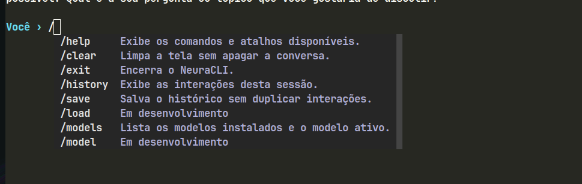
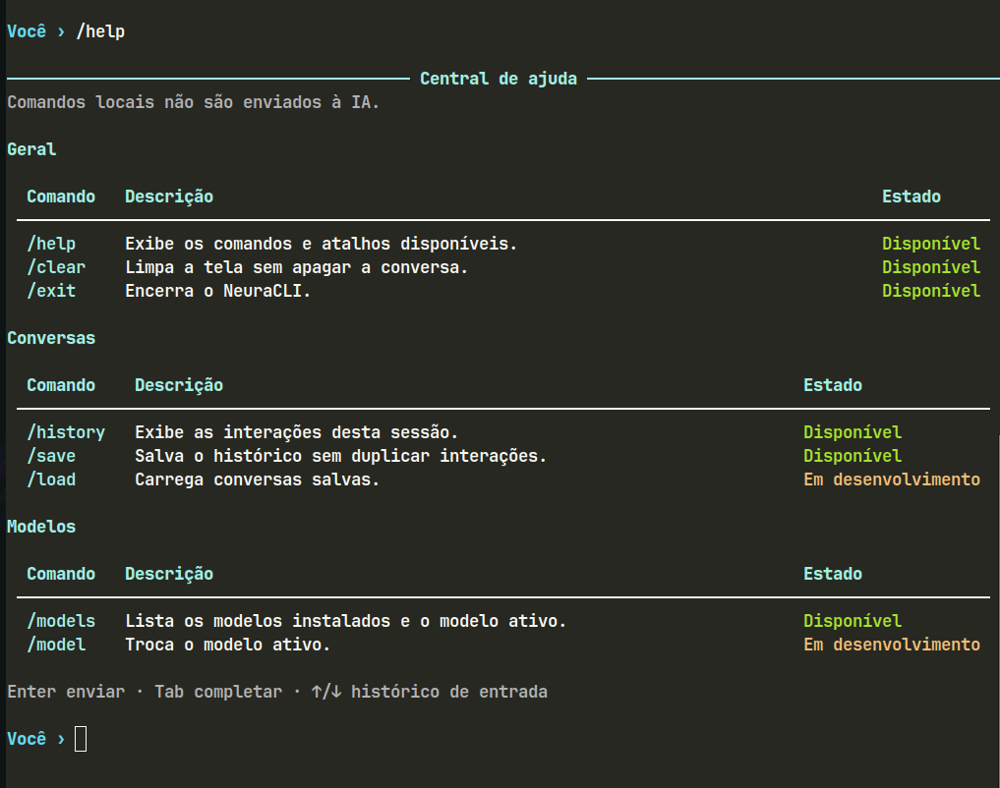
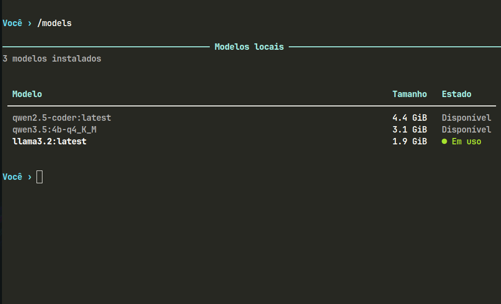
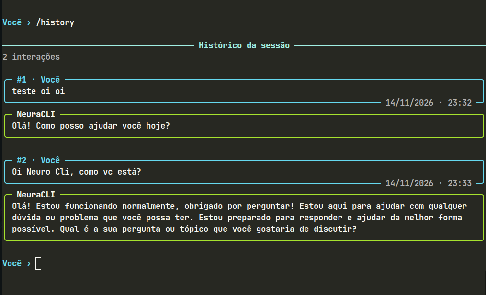
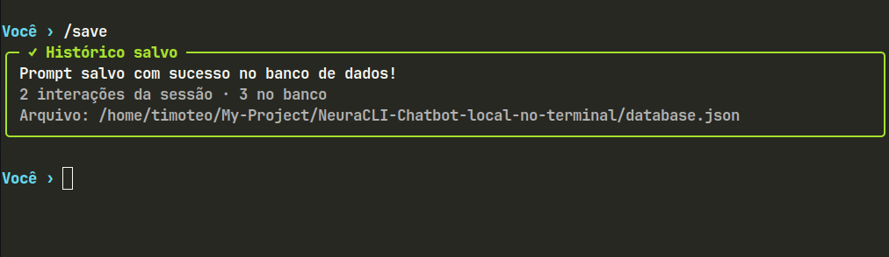

# NeuraCLI

### Inteligência artificial local, direto no terminal.


[](LICENSE)

**NeuraCLI** é um assistente de inteligência artificial open-source, desenvolvido em Python e integrado ao Ollama para conversar com modelos de linguagem diretamente pelo terminal.

A proposta é oferecer uma experiência acessível, personalizável e orientada à execução local, sem exigir serviços de inferência em nuvem ou APIs pagas quando utilizado com modelos locais.

> **Versão atual: 0.1.0 — desenvolvimento inicial.**
>
> O projeto já oferece conversação, respostas em streaming, histórico da sessão e salvamento local. Recursos adicionais estão em desenvolvimento.


## Visão do projeto

Construir, junto à comunidade, um assistente de terminal capaz de **alcançar ou superar a experiência de ferramentas como o OpenCode**, priorizando:

- **Execução local:** liberdade para utilizar modelos na própria máquina.
- **Controle:** escolha dos modelos e armazenamento local das conversas.
- **Experiência de uso:** interface clara, comandos acessíveis e respostas bem formatadas.
- **Código aberto:** transparência, colaboração e liberdade de adaptação.
- **Evolução contínua:** uma base extensível para novas ferramentas e integrações.

Essa é uma **ambição de longo prazo**, não uma equivalência já alcançada. Na versão `0.1.0`, o NeuraCLI é um chatbot de terminal; ainda não executa tarefas autônomas, edita arquivos ou executa comandos do sistema.

## Funcionalidades da versão 0.1.0

- Conversação em linguagem natural com modelos do Ollama.
- Respostas exibidas progressivamente por streaming.
- Renderização de Markdown e blocos de código.
- Interface com cores, painéis e identificação das mensagens.
- Autocompletar para comandos iniciados por `/`.
- Consulta das interações realizadas na sessão.
- Salvamento manual das conversas em JSON.
- Salvamento repetido sem duplicar as mesmas interações.
- Listagem dos modelos instalados, com identificação do modelo ativo.
- Tratamento de falhas de conexão e interrupções pelo teclado.

### Conversando com o NeuraCLI



## Tecnologias

| Tecnologia | Finalidade |
|---|---|
| **Python** | Implementação da aplicação e dos comandos. |
| **Ollama** | Execução dos modelos e integração com a aplicação pelo SDK Python. |
| **Rich** | Interface visual, Markdown, tabelas e apresentação das respostas. |
| **Prompt Toolkit** | Entrada interativa, autocompletar e navegação pelo teclado. |
| **JSON** | Armazenamento local das interações salvas. |
| **unittest** | Testes de histórico, salvamento e interface. |

## Pré-requisitos

Para executar o projeto, você precisará de:

- **Python**, preferencialmente **3.13**, com `pip` e suporte a `venv`.
- **Git**, para clonar o repositório.
- **Ollama** instalado e em execução.
- Pelo menos um modelo baixado no Ollama.
- Memória RAM e espaço em disco compatíveis com o modelo escolhido.

As instruções abaixo consideram **Linux**, ambiente atual de desenvolvimento. A compatibilidade com outros sistemas ainda precisa ser validada.

> Uma GPU pode melhorar o desempenho, mas a necessidade de aceleração e os requisitos de memória dependem do modelo e do suporte do Ollama ao seu hardware.

## Instalação e execução

### 1. Clone o repositório

```bash
git clone https://github.com/rafgam10/NeuraCLI-Chatbot-local-no-terminal.git
cd NeuraCLI-Chatbot-local-no-terminal
```

### 2. Crie e ative um ambiente virtual

```bash
python3 -m venv .venv
source .venv/bin/activate
```

### 3. Instale as dependências

```bash
python -m pip install -r requirements.txt
```

### 4. Prepare o Ollama

Instale o Ollama seguindo as instruções em [ollama.com/download](https://ollama.com/download).

Caso o serviço ainda não esteja em execução, abra outro terminal e execute:

```bash
ollama serve
```

Com o serviço disponível, baixe um modelo:

```bash
ollama pull llama3.2
```

Confira os modelos instalados:

```bash
ollama list
```

### 5. Inicie o NeuraCLI

Com o ambiente virtual ativo:

```bash
python run.py llama3.2
```

O nome do modelo é obrigatório. Você pode substituí-lo por outro modelo instalado no Ollama.

### 6. Comece a conversar

Digite uma mensagem e pressione `Enter`:

```text
Você › Explique o que é uma função em Python.
```

Para consultar os comandos:

```text
/help
```

> Com as dependências e um modelo local já instalados, é possível conversar sem internet, mantendo o Ollama em execução na própria máquina.

## Comandos

Os comandos são processados pela aplicação e **não são enviados como mensagens à IA**.

| Comando | O que faz | Estado |
|---|---|---|
| `/help` | Mostra os comandos, suas descrições e os atalhos disponíveis. | Disponível |
| `/clear` | Limpa a tela e reapresenta o cabeçalho, sem apagar o histórico da sessão. | Disponível |
| `/exit` | Encerra a aplicação. Não salva automaticamente as conversas. | Disponível |
| `/history` | Exibe as perguntas e respostas concluídas na sessão atual. | Disponível |
| `/save` | Salva o histórico da sessão em `database.json`, preservando registros existentes e evitando duplicações das mesmas interações. | Disponível |
| `/load` | Previsto para carregar conversas salvas. Ainda não realiza o carregamento. | Em desenvolvimento |
| `/models` | Lista os modelos instalados, seus tamanhos e qual está em uso. | Disponível |
| `/model` | Previsto para trocar o modelo durante a sessão. Ainda não realiza a troca. | Em desenvolvimento |

Os comandos disponíveis atualmente não recebem argumentos.

Para usar outro modelo nesta versão, encerre a aplicação e inicie novamente com o nome desejado.

### Atalhos

| Atalho | Ação |
|---|---|
| `Enter` | Envia a mensagem ou executa o comando. |
| `Tab` | Completa comandos. |
| `↑` / `↓` | Navega pelas entradas anteriores da sessão. |
| `Ctrl+C` | Cancela a entrada ou interrompe a resposta, sem encerrar o chat. |
| `Ctrl+D` | Encerra a aplicação quando utilizado na entrada vazia. |

Digite `/` para visualizar as sugestões de comandos.



## Histórico e armazenamento

O NeuraCLI registra as interações concluídas durante a sessão. Cada registro contém um identificador, data, pergunta e resposta.

- Use `/history` para consultar as interações da sessão atual.
- Use `/save` para persistir essas interações.
- Os dados são gravados em **`database.json`**, na raiz do projeto.
- O salvamento é **manual**: execute `/save` antes de sair.
- Interações interrompidas não são registradas como concluídas.

> **Histórico não significa memória de contexto:** nesta versão, as mensagens anteriores não são reenviadas ao modelo. Cada resposta é gerada a partir da mensagem atual.

**Privacidade:** o arquivo JSON armazena conversas em texto, sem criptografia. Não publique conversas pessoais, credenciais ou informações confidenciais em commits, issues ou pull requests.

## Capturas de tela

<details>
<summary><strong>Ver central de ajuda, modelos, histórico, salvamento e encerramento</strong></summary>

### Central de ajuda



### Modelos instalados



### Histórico da sessão



### Salvamento das conversas



### Encerramento


</details>

## Limitações atuais

A versão `0.1.0` ainda não oferece:

- Carregamento de conversas pelo comando `/load`.
- Troca de modelo durante a sessão pelo comando `/model`.
- Memória contextual entre as mensagens.
- Salvamento automático.
- Leitura e edição de arquivos do projeto.
- Execução de comandos ou fluxos autônomos de desenvolvimento.

A qualidade e a velocidade das respostas dependem do modelo escolhido e dos recursos disponíveis na máquina.

## Roadmap proposto

### Conversação e experiência de uso

- [ ] Implementar memória contextual entre mensagens.
- [ ] Habilitar o carregamento de conversas com `/load`.
- [ ] Permitir troca de modelos com `/model`.
- [ ] Evoluir o gerenciamento e a organização das sessões.

### Assistência ao desenvolvimento

- [ ] Adicionar leitura de arquivos e contexto do projeto.
- [ ] Propor alterações de código com revisão pelo usuário.
- [ ] Explorar execução de ferramentas com permissões explícitas.
- [ ] Criar uma arquitetura extensível para integrações.

### Comunidade e qualidade

- [ ] Ampliar a cobertura de testes.
- [ ] Validar outras versões do Python e sistemas operacionais.
- [ ] Automatizar verificações de qualidade.
- [ ] Evoluir a documentação e os exemplos de uso.

O roadmap apresenta direções de evolução, não funcionalidades já disponíveis nem prazos garantidos. As prioridades podem ser discutidas com a comunidade.

## Como contribuir

O NeuraCLI é um projeto **open-source**, e contribuições são bem-vindas — inclusive de quem está começando.

Você pode contribuir com:

- Relatos de bugs e sugestões de funcionalidades.
- Melhorias na interface e na documentação.
- Testes e correções.
- Novas integrações e ferramentas.
- Feedback sobre modelos e desempenho.

Para contribuir com código:

1. Faça um fork do repositório.
2. Crie uma branch para sua alteração.
3. Desenvolva a melhoria e adicione testes quando aplicável.
4. Abra um pull request explicando o problema e a solução.

Para mudanças maiores, abra uma [issue](https://github.com/rafgam10/NeuraCLI-Chatbot-local-no-terminal/issues) antes de iniciar a implementação.

## Licença

Distribuído sob a **licença MIT**. Você pode usar, estudar, modificar e distribuir o projeto conforme as condições descritas em [LICENSE](LICENSE).

**Autor:** [Rafael Timóteo Costa Oliveira](https://github.com/rafgam10)

---

**NeuraCLI — construído de forma aberta, para evoluir com a comunidade.**
